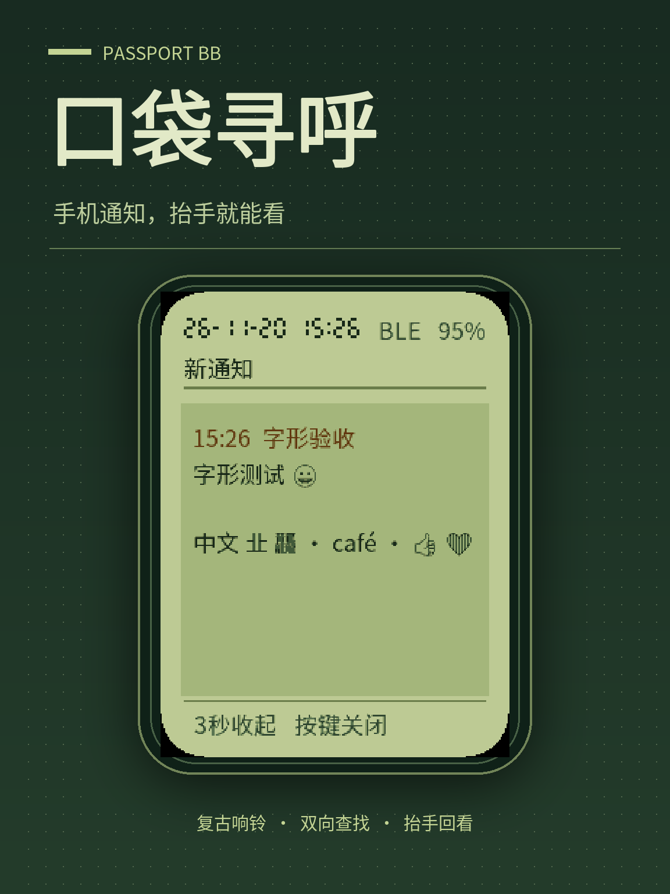
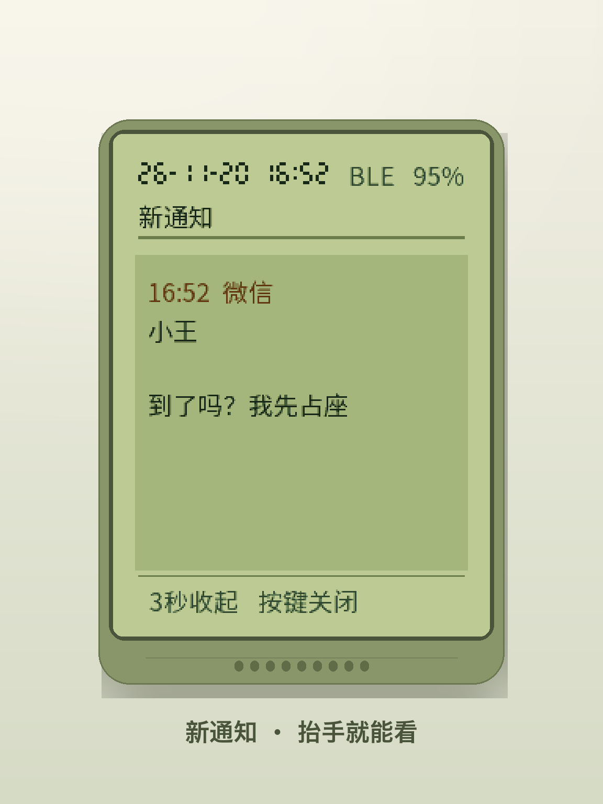
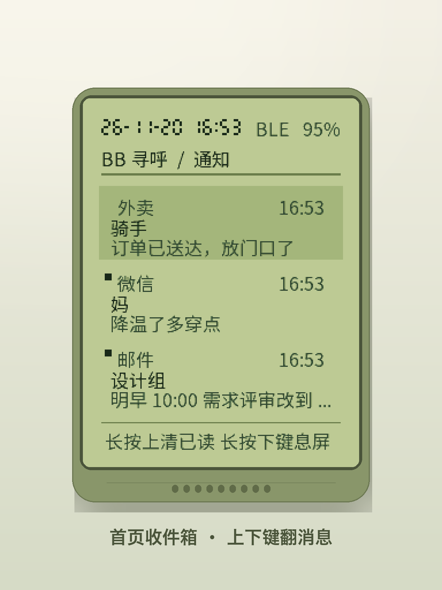
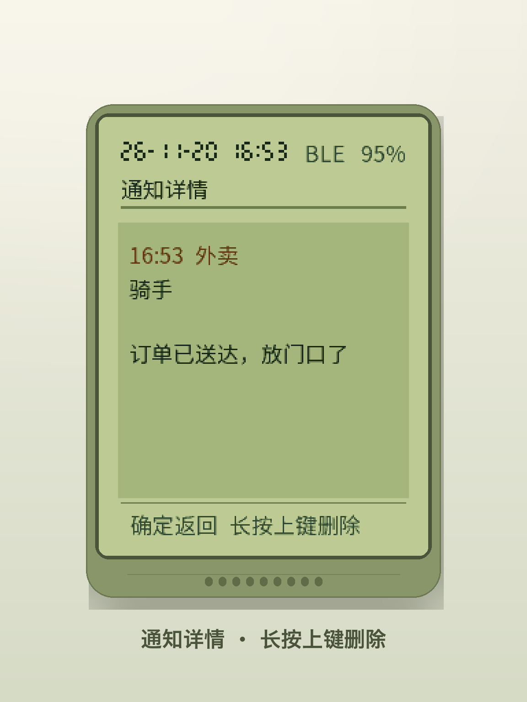
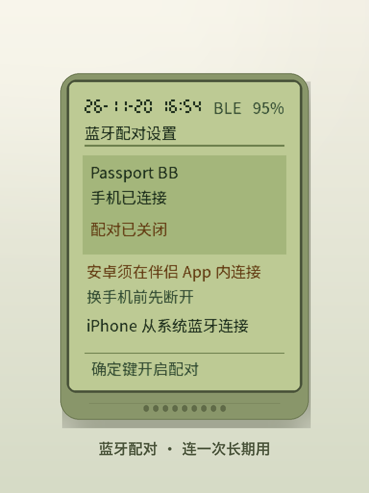
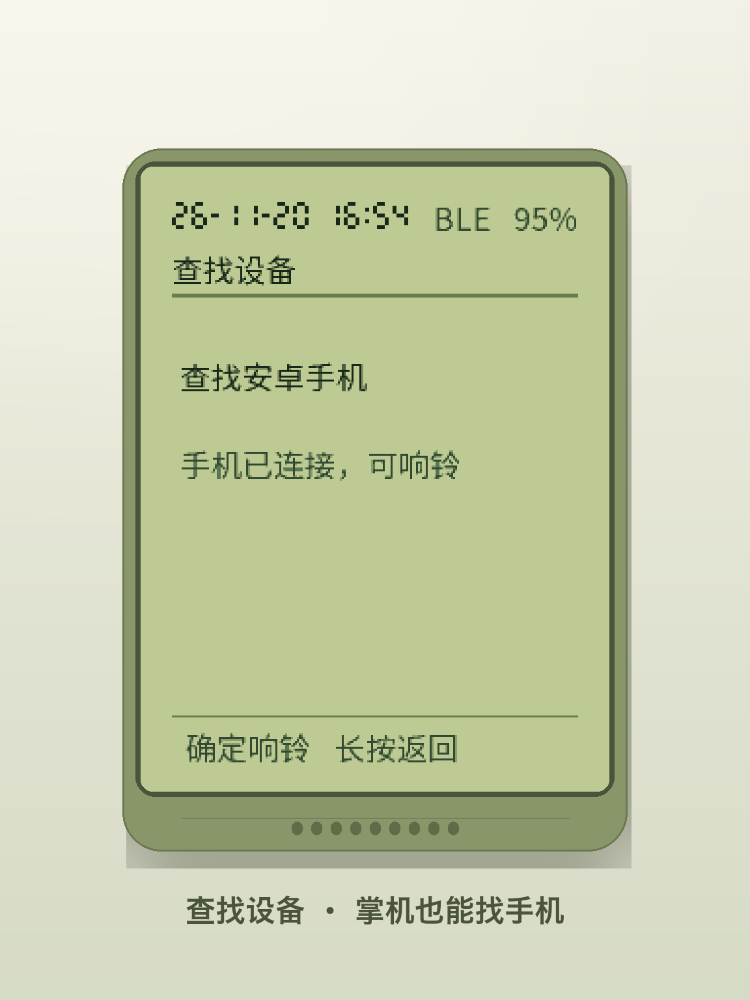

# Passport BB · 口袋寻呼 / Pocket Pager

把 FoloToy AI Passport 变成一只复古寻呼机：手机上的通知经蓝牙推送过来，橄榄绿液晶界面、七段数字时钟和两声短鸣，抬手就能看到应用名、标题和正文。

Turn a FoloToy AI Passport into a pocket pager: phone notifications arrive over Bluetooth and show up on an olive-green LCD with segmented digits and a double beep.



## 玩法 / What it does

- 收到通知弹出提醒，显示应用名、标题和正文，3 秒自动收起或按键关闭
- 首页收件箱按时间排列，上下键选择，短按「确定」查看详情
- 详情页长按上键再按确定，删除这一条；首页长按上键清除已读
- 重要应用可设为常驻提醒，一直留到按键
- 长按下键息屏，按任意功能键唤醒；息屏显示七段数字时钟
- 安卓可在「通知伴侣」里让掌机响铃，掌机菜单「查找设备」可让手机响铃
- 菜单「媒体控制」直接控制手机音乐：上键上一首、下键下一首、确定键播放或暂停
- 功能菜单是两列宫格，十项功能一屏看全
- 收件箱右侧有竖向进度条，标题栏显示「第几条/共几条」
- 收件箱长按上键：确认页可「清除全部」或切到「清除已读」，确定即执行

Screens captured from the device:

| 新通知 | 收件箱 | 通知详情 |
|---|---|---|
|  |  |  |

| 蓝牙配对 | 查找设备 |
|---|---|
|  |  |

## 目录 / Layout

```
firmware/   掌机固件（ESP-IDF 工程；main/ 为寻呼应用，components/bsp 为板级驱动）
android/    安卓「通知伴侣」源码（无 Gradle，直接调 aapt2/d8/apksigner 构建）
docs/       使用方法（中/英）、隐私政策、更新日志
images/     真机截屏与封面
```

本仓库只保留构建与运行所需的代码：上游工程里的 `firmware/assets`（演示图片）、`firmware/docs`（
上游开发文档）、`firmware/skills`（本地辅助脚本说明）和 `firmware/tests`（主机侧打桩测试）没有收录，
不影响固件构建。This repository keeps only what is needed to build and run the play; the upstream
`firmware/assets`, `firmware/docs`, `firmware/skills` and `firmware/tests` trees are omitted.

## 编译固件 / Build the firmware

需要 ESP-IDF 5.5.x（工程约束 `< 5.6.0`），目标 `esp32c3`，8 MB flash。

```bash
cd firmware
idf.py set-target esp32c3
idf.py build
```

产物 `build/FoloToy-AI-Passport.bin` 为应用镜像；整包发布镜像可由 `flash_args` 中的 bootloader + partition table + app 合并，或直接 `idf.py -p <PORT> flash` 写入。

Requires ESP-IDF 5.5.x (the project pins `< 5.6.0`), target `esp32c3` with 8 MB flash. Use `idf.py set-target esp32c3 && idf.py build`, then `idf.py -p <PORT> flash`.

### 串口截屏协议 / Serial screenshot protocol

固件实现了 `FAP_SCREENSHOT_V1`：主机向串口写入一行该命令，设备回 `FAP_SCREENSHOT_V1 240 320 RGB565LE 153600` 头部加逐行像素数据（见 `firmware/main/pager_screenshot.c`）。协议只读，不重启、不擦写。

## 编译安卓伴侣 / Build the Android companion

需要 JDK 17 与 Android SDK（build-tools 36.0.0、platform android-35）：

```bash
ANDROID_SDK_ROOT=~/Library/Android/sdk ./android/build.sh
```

脚本用本地测试密钥签名，仅供自己安装调试；正式分发请替换为自己的发布密钥。

Needs JDK 17 + Android SDK (build-tools 36.0.0, platform android-35). `build.sh` signs with a throwaway local key — replace it with your own release key before distributing.

## 许可 / License

MIT，见 `LICENSE`。基于 FoloToy AI Passport 官方示例工程开发。
